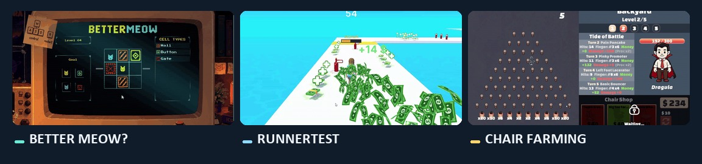
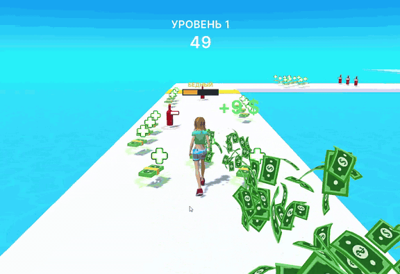
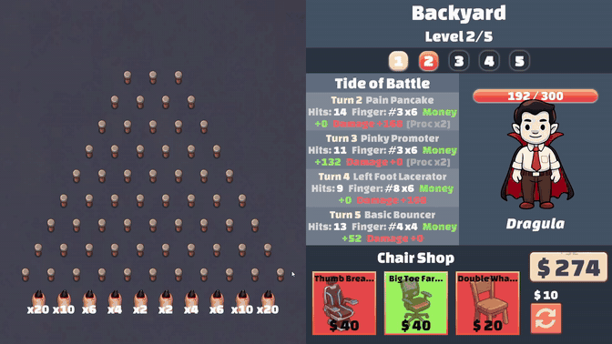

<h1 align="center">Roman Moiseev</h1>

<strong>Unity Developer · C# · Gameplay, UI &amp; Tools</strong>

  <a href="https://whitecloh.itch.io/">Play my games on itch.io</a> ·
  <a href="https://t.me/whiteCloh">Telegram</a>

I build gameplay features, UI and content tools for mobile and browser games. My commercial work includes live event tooling, PlayFab integrations and game animation. I also make small Unity games with a focus on clear mechanics and satisfying feedback.

**Core tools** · Unity 6 · C# · uGUI · DOTween · Spine · ScriptableObject · LeoEcsLite · PlayFab

## Featured projects

### [Better Meow?](https://github.com/whitecloh/Better-Meow)

**Puzzle · Browser · Two-person jam team**

One input moves two cats in different directions. Read the board, use buttons and gates, and bring both characters to their goals. I worked on Unity development, including movement rules separated from the board presentation.

[Play in browser](https://whitecloh.itch.io/better-meow) · [Source code](https://github.com/whitecloh/Better-Meow)

### [RunnerTest](https://github.com/whitecloh/RunnerTest)

**3D runner · Unity gameplay sample**

A short runner built around lane movement, pickups and gates. Configurable gameplay and feedback use ScriptableObjects. The repository shows LeoEcsLite systems, an authored level prefab and an Editor validator.

[Source code](https://github.com/whitecloh/RunnerTest) · [Architecture](https://github.com/whitecloh/RunnerTest/blob/main/Docs/Architecture.md)

### [Chair Farming: Toe Siege](https://github.com/whitecloh/ChairFarming)

**Arcade strategy · Browser &amp; Windows · Mini Jame Gam #53**

Pick a chair, drop it into a Plinko board, then use the result to earn money or deal damage. The shop and enemy progression turn a single drop into a short strategy loop. I worked on Unity development in a two-person jam team.

[Play in browser](https://whitecloh.itch.io/cftoesiege) · [Source code](https://github.com/whitecloh/ChairFarming) · [Jam entry](https://itch.io/jam/mini-jame-gam-53/rate/4451497)
