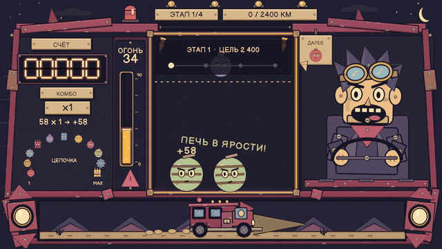
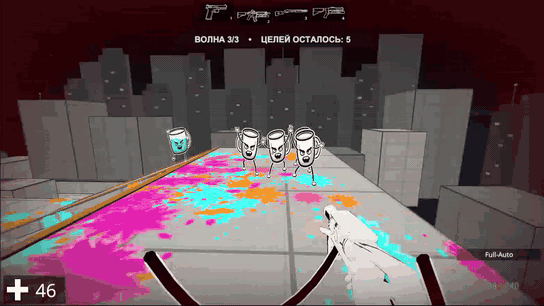
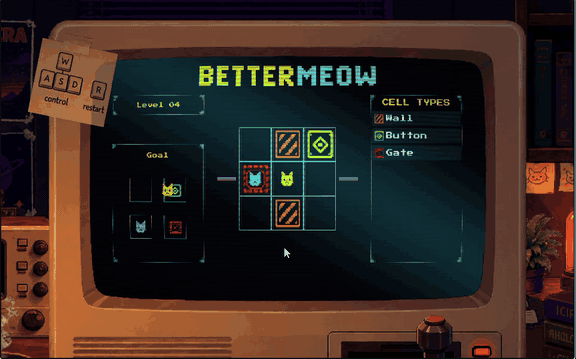
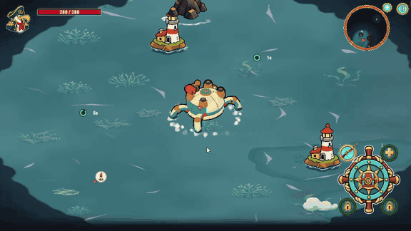

<h1 align="center">Roman Moiseev</h1>

<strong>Unity Developer · C# · Gameplay, UI &amp; Tools</strong>

  <a href="https://whitecloh.itch.io/">itch.io</a> ·
  <a href="https://t.me/whiteCloh">Telegram</a>

I build Unity gameplay, UI and tools for mobile and browser games. My commercial work includes live events, PlayFab integrations and game animation.

## Selected gameplay

[FURIKA](#furika) · [HexaWorld](#hexaworld) · [Better Meow?](#better-meow) · [CandyWandy](#candywandy)

### FURIKA

**2D casual · Physics and game feel · Prototype**

Toss items into a flask and merge matching pieces. The throw, collisions and merge effects make each drop readable and satisfying.

### HexaWorld

**3D first-person combat · Weapon feedback · Prototype**

Move through a 3D arena and shoot approaching enemies. Recoil, paint bursts and enemy reactions make hits easy to read amid the action.

### Better Meow?

**Logic puzzle · Browser release · Two-person jam team**

One input moves a cat and its copy under different rules. Use buttons, gates and walls to bring both to their goals. I worked on Unity development, including the separation of movement rules from the board presentation.

[Play in browser](https://whitecloh.itch.io/better-meow) · [Source code](https://github.com/whitecloh/Better-Meow)

### CandyWandy

**Top-down prototype · Stylized water and motion**

Navigate a painted sea past rocks and lighthouses. Foam and ripples give movement and turns a visible response.

**Tools** · Unity 6 · C# · uGUI · DOTween · Spine · ScriptableObject · PlayFab
